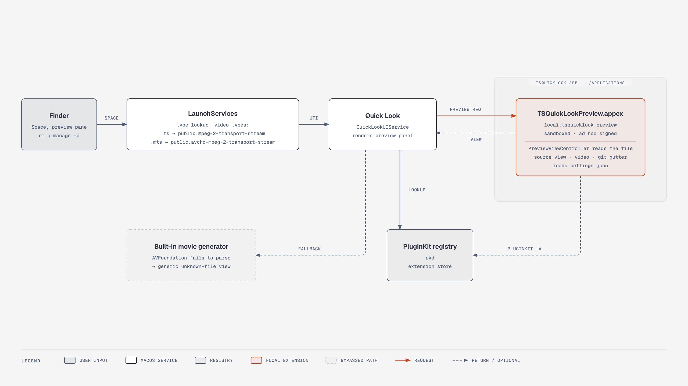

# TSQuickLook

A small macOS Quick Look extension that previews `.ts` and `.mts` TypeScript files as syntax-highlighted source, in the Quick Look panel and in Finder's preview pane.

## Why

macOS assigns the `.ts` extension to MPEG-2 transport stream video (`public.mpeg-2-transport-stream`) and `.mts` to AVCHD video (`public.avchd-mpeg-2-transport-stream`). Quick Look therefore treats TypeScript files as broken movies and shows the generic file preview. Source-code previewers such as Syntax Highlight do not claim those two types, so they are never asked.

TSQuickLook claims both types. A file that holds text is shown as source; a file that is a real transport stream plays as video.

## Features

- Highlighted source with line numbers. Long lines wrap to the width of the preview.
- Works in Finder's preview pane (View > Show Preview) as well as the Quick Look panel.
- Copy button above the source. It puts the file's text on the clipboard.
- Git change bars beside the line numbers: green for added lines, orange for modified lines, a red marker where lines were removed. A file with uncommitted changes is compared with `HEAD`; a clean file shows the lines its last commit touched. The bar above the source shows the summary.
- Video player with inline controls for real MPEG transport streams.
- Settings app for appearance, font, preview size and the list of file extensions.

## Requirements

- macOS 13 or later. Tested only on macOS 27.3 beta on Apple Silicon.
- Xcode or the Command Line Tools (`xcode-select --install`) for `swiftc`, `clang` and `codesign`.

## Install

```sh
git clone git@github.com:gootecks/ts-quicklook.git
cd ts-quicklook
mise run install
```

Without `mise`: `sh scripts/install.sh`.

The script builds the app, signs it ad hoc, copies it to `~/Applications/TSQuickLook.app`, registers the extension and restarts Quick Look. Select a `.ts` file in Finder and press Space.

Check the registration:

```sh
pluginkit -m -A -D -v -i local.tsquicklook.preview
```

Try it from the terminal:

```sh
qlmanage -p examples/sample.ts
```

## Settings

Open `~/Applications/TSQuickLook.app`. The window has five sections:

| Section | What it sets |
|---|---|
| Extension | Shows whether the extension is registered; **Re-register** registers it again |
| Appearance | Auto, light or dark |
| Font | Font and font size |
| Preview size | Fit to content, or a fixed width and height |
| File extensions | Which extensions the preview claims: `.ts`, `.mts`, `.cts`, `.tsx`, `.js`, `.mjs`, `.cjs`, `.jsx` or your own |

Appearance, font and size take effect on the next preview. A change to the extension list needs **Apply**: it rewrites `QLSupportedContentTypes` in the installed extension, signs it again and registers it. An extension that macOS has no content type for is skipped and named in the result.

Settings are stored in `~/Library/Application Support/TSQuickLook/settings.json`. `TSQuickLook --apply` applies the saved extension list without opening a window; the install script runs it, so a reinstall keeps your selection.

## Uninstall

```sh
mise run uninstall
```

Without `mise`: `sh scripts/uninstall.sh`.

## How it works



- `TSQuickLook.app` is the container app and the settings window. macOS only loads extensions that live inside an app bundle.
- `TSQuickLookPreview.appex` is a sandboxed, view-based Quick Look preview extension. Its `Info.plist` lists the claimed types under `QLSupportedContentTypes`.
- `PreviewViewController` reads the file and decides what to show: source, video or a notice for other binary data.
- `Renderer` tokenizes the source with one regular expression and builds an attributed string for a native text view. No HTML or JavaScript is involved.
- `TransportStream` checks for MPEG sync bytes at 188, 192 or 204 byte intervals. A match plays in an `AVPlayerView`.
- `GitRepository`, `GitObjectStore` and `LineDiff` read `.git` directly (refs, index, loose and packed objects) and diff in-process. The sandbox does not let the extension start `git`.
- The sandbox has read-only access to the file system. The extension needs it to read the settings file and the `.git` directory, which lie outside the previewed file.

The diagram source is `docs/architecture.html`.

## Limitations

- A `.ts` or `.mts` file that is neither text nor a transport stream shows a one-line notice.
- The highlighter is a tokenizer, not a parser. Regular-expression literals are not recognized, and JSX in `.tsx` and `.jsx` files is coloured as plain TypeScript.
- Files larger than 2 MB are cut off at 2 MB.
- Git change bars are skipped for files larger than 4 MB. The search for a clean file's last commit stops after 1.5 seconds; the summary then shows "No uncommitted changes".
- In a preview narrower than 220 points, which includes Finder's preview pane at its default width, the summary text is hidden. The change bars stay.
- The build is signed ad hoc for the machine that built it. It is not notarized and is not meant to be distributed as a binary.
- Thumbnails and Spotlight are not covered.

## Troubleshooting

- **The extension does not register.** Read the reason from PlugInKit: `log show --last 1m --predicate 'process == "pkd"'`. PlugInKit rejects extensions under `/tmp`; keep the app in `~/Applications`.
- **The old preview still appears.** Run `qlmanage -r; qlmanage -r cache; killall QuickLookUIService` and try again.
- **Check which extension handled a file.** Run `qlmanage -p file.ts`, then `log show --last 30s --info --predicate 'eventMessage CONTAINS "xpcservice<"'` and look for `local.tsquicklook.preview`.

## Layout

| Path | Purpose |
|---|---|
| `Sources/Extension/` | Preview extension: view controller, highlighter, toolbar, gutter, video, git reader |
| `Sources/App/` | Settings app and extension registration |
| `Sources/Shared/` | Settings model used by both |
| `Resources/` | `Info.plist` files and the extension entitlements |
| `scripts/` | `build.sh`, `install.sh`, `uninstall.sh` |
| `examples/sample.ts` | Sample file for a manual check |
| `docs/` | Architecture diagram, preview pane notes |

See [CHANGELOG.md](CHANGELOG.md) for release notes.
